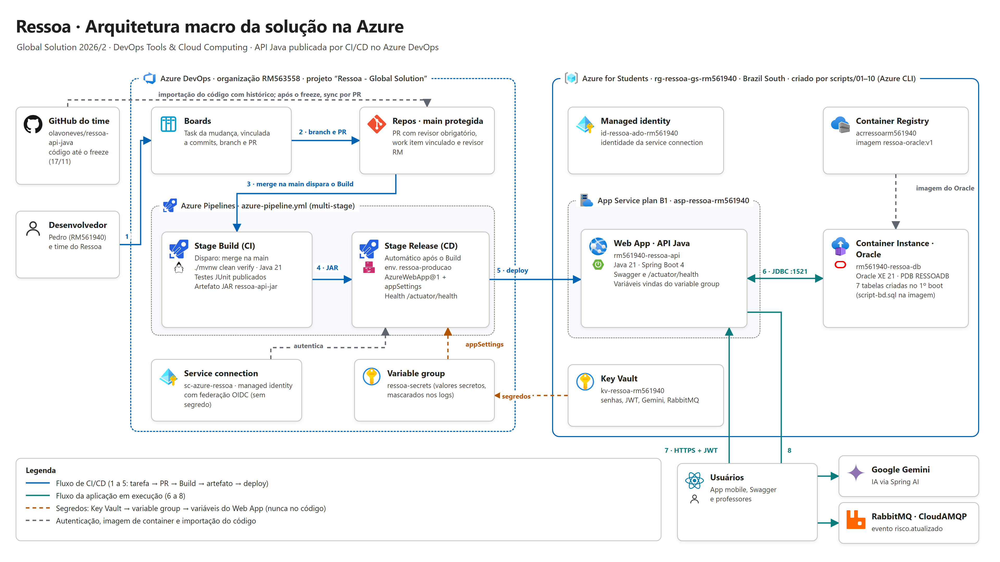

# Ressoa: DevOps (Azure CLI + Azure DevOps)

Só a API Java vai para a Azure, num Azure Web App; as APIs que atendem o app mobile seguem no Render. O Oracle XE roda em container (ACI, com a imagem no ACR). Os segredos ficam no Key Vault e chegam à aplicação por um variable group secreto. O CI/CD fica no `azure-pipeline.yml`, na raiz do repositório.

## Arquitetura



1. A tarefa nasce no Azure Boards.
2. O código vai por branch e PR para a `main` do Azure Repos, com revisor e work item obrigatórios.
3. O merge dispara o stage **Build**: `mvnw clean verify` e testes publicados.
4. O JAR vira artefato da pipeline.
5. O stage **Release** faz o deploy no Web App `rm561940-ressoa-api`, com os segredos do variable group `ressoa-secrets` (copiados do Key Vault), e confere o `/actuator/health`.
6. A API grava no Oracle XE do ACI (imagem no ACR) por JDBC.
7. Os usuários acessam a API por HTTPS com JWT.
8. A API chama o Google Gemini e publica eventos no RabbitMQ (CloudAMQP).

## Pré-requisitos

- Git Bash com `az` logado (`az login`) numa conta Owner da assinatura e administradora da organização `RM563558`.
- `openssl` e `curl`, que já vêm com o Git Bash. O Docker Desktop só é necessário se o ACR Tasks estiver bloqueado na assinatura (veja o script 03).
- Rodar os scripts a partir da pasta `scripts/`, por exemplo `./01_resource-group.sh`. Todos os nomes ficam em `00_variables.sh`, que não contém nenhuma senha.

## Ordem de execução

| # | Script | O que faz | Custo |
|---|---|---|---|
| 01 | `01_resource-group.sh` | Registra os providers e cria o grupo `rg-ressoa-gs-rm561940` | — |
| 02 | `02_key-vault.sh` | Cria o Key Vault e gera as senhas (Oracle, JWT, usuários de demonstração). Pede, sem eco, a chave do Gemini e a URL do RabbitMQ | centavos |
| 03 | `03_acr.sh` | Cria o ACR e gera a imagem `dockerfiles/Dockerfile.oracle` (Oracle XE + `scripts/script-bd.sql`) | baixo |
| 04 | `04_aci-db.sh` | Sobe o Oracle no ACI (2 vCPU / 4 GB). As tabelas nascem no primeiro boot. Espera até 10 min | **por hora** |
| 05 | `05_webapps.sh` | Cria o plano B1 e o Web App `rm561940-ressoa-api` (Java 21) | **por hora** |
| 06 | `06_azure-devops.sh` | Cria o projeto, se ainda não existir, e dá aos professores acesso Basic e o grupo Project Administrators | — |
| — | *(uma vez)* | Importa o código no Azure Repos (veja [Código no Azure Repos](#código-no-azure-repos)) | — |
| 06b | `06b_politicas-main.sh` | Protege a `main`: revisor obrigatório, work item vinculado e revisor padrão RM561940 | — |
| 07 | `07_variable-group.sh` | Copia os segredos do Key Vault para o variable group `ressoa-secrets` | — |
| 08 | `08_service-connection.sh` | Cria a service connection `sc-azure-ressoa` (managed identity + federação, sem segredo) | — |
| 09 | `09_pipeline.sh` | Registra a pipeline `ressoa-api` e autoriza só ela no environment `ressoa-producao`, no variable group e na service connection | — |
| 10 | `10_smoke-tests.sh` | Espera a API subir (até 10 min), faz login como `gestor@ressoa.app` e roda o CRUD de `BAIRRO` e `DISPOSITIVO` | — |

Rotina diária: `97_pausar.sh` ao terminar a sessão e `98_retomar.sh` ao voltar. O 97 desliga o ACI e o Web App e baixa o plano para F1. O banco volta zerado, mas com as tabelas recriadas, porque o ACI não tem volume; a API refaz a carga inicial no próximo startup. O `99_cleanup.sh` apaga o grupo inteiro: só depois da nota.

## Banco de dados

O DDL é o `scripts/script-bd.sql` do time, fonte única do modelo (7 tabelas, incluindo `NOTIFICACAO`). O `dockerfiles/Dockerfile.oracle` copia esse arquivo para a imagem do Oracle e o aplica no esquema `RESSOA` do PDB `RESSOADB` no primeiro boot. O `dockerfiles/Dockerfile` é a imagem da API usada no Render e não participa do deploy na Azure.

## Pipeline (`azure-pipeline.yml`)

1. **Build**: dispara a cada commit na `main`. Como a `main` é protegida, isso só acontece no merge de um PR. Roda `./mvnw clean verify` (testes no perfil `test`, com H2), publica os testes JUnit com `PublishTestResults` e publica o artefato `ressoa-api-jar` (um único JAR executável).
2. **Release**: roda automaticamente depois do Build. Faz o deploy do JAR no `rm561940-ressoa-api` e grava as variáveis de ambiente do variable group. No fim, espera o `/actuator/health` responder `UP` (até 10 min).

## Variáveis de ambiente da API

Os nomes são os que a API lê (`src/main/resources/application.properties` e `.env.example`):

| Variável | Valor na Azure | Origem |
|---|---|---|
| `DB_URL` | `jdbc:oracle:thin:@//rm561940-ressoa-db.brazilsouth.azurecontainer.io:1521/RESSOADB` | variable group |
| `DB_USERNAME` | `ressoa` | variable group |
| `DB_PASSWORD` | segredo | Key Vault → variable group |
| `JWT_SECRET` | segredo | Key Vault → variable group |
| `SEED_SENHA_PADRAO` | segredo | Key Vault → variable group |
| `GEMINI_API_KEY` | segredo | Key Vault → variable group |
| `RABBITMQ_URL` | segredo (URL `amqps://` do CloudAMQP) | Key Vault → variable group |

As demais (`SEED_HABILITADO`, `CORS_ORIGENS`, `AI_CHAT_PROVIDER`, `GEMINI_MODEL`, `HEALTH_RABBIT`, `JPA_DDL_AUTO`) ficam no padrão do `application.properties`. Em especial, `ddl-auto=validate`: o Hibernate só confere o esquema criado pelo `script-bd.sql`.

**Usuários de demonstração.** Com o banco vazio, a API cria `gestor@ressoa.app`, `ia-servico@ressoa.app`, `morador@ressoa.app` e `joao@ressoa.app`, todos com a senha `SEED_SENHA_PADRAO`. Para consultá-la:

```bash
az keyvault secret show --vault-name kv-ressoa-rm561940 --name seed-senha-padrao --query value -o tsv
```

**Health e RabbitMQ.** O `/actuator/health` inclui o Oracle e o RabbitMQ. Com o `RABBITMQ_URL` do CloudAMQP certo, ele fica `UP`; se o RabbitMQ cair, ele responde 503 e a Release falha. A verificação continua no `/actuator/health` porque é ela que prova app + banco. Plano B, só se o CloudAMQP estiver fora do ar na gravação: tirar o RabbitMQ do health. A configuração sobrevive aos próximos deploys, porque a pipeline só grava as variáveis da tabela acima.

```bash
az webapp config appsettings set -g rg-ressoa-gs-rm561940 -n rm561940-ressoa-api --settings HEALTH_RABBIT=false
```

## Código no Azure Repos

O código veio do GitHub (`olavoneves/ressoa-api-java`) com o histórico completo, para o repositório padrão do projeto. Em seguida, um commit na `main` acrescentou estes arquivos de DevOps, e só depois o `06b` protegeu a `main`. Para refazer num projeto novo (o repositório precisa estar vazio):

```bash
az repos import create --git-source-url https://github.com/olavoneves/ressoa-api-java \
  --repository "Ressoa - Global Solution" \
  --org https://dev.azure.com/RM563558 --project "Ressoa - Global Solution"
```

### Sincronização com o GitHub depois do freeze (17/11)

O time desenvolve no GitHub até o freeze. Depois disso, os commits novos do GitHub entram no Azure Repos por PR, porque a política da `main` recusa push direto:

1. No Boards, crie uma tarefa para a sincronização.
2. Traga o GitHub para uma branch `sync/github`, com histórico:

   ```bash
   git clone https://RM563558@dev.azure.com/RM563558/Ressoa%20-%20Global%20Solution/_git/Ressoa%20-%20Global%20Solution ressoa-azure
   cd ressoa-azure
   git remote add github https://github.com/olavoneves/ressoa-api-java.git
   git fetch github
   git switch -c sync/github origin/main
   git merge --no-edit github/main
   git push -u origin sync/github
   ```

3. Abra a PR para a `main`, vinculada à tarefa, e aprove:

   ```bash
   az repos pr create --source-branch sync/github --target-branch main \
     --title "Sincroniza com o GitHub" --work-items <ID_DA_TAREFA>
   ```

O merge da PR dispara o Build e a Release. O GitHub não mexe nos arquivos de DevOps, então o merge não deve ter conflito; se um dia tiver, vale a versão do Azure Repos para `azure-pipeline.yml`, `README-DEVOPS.md`, `dockerfiles/Dockerfile.oracle`, `dockerfiles/oracle-init/` e os `scripts/*.sh`. Nada é enviado de volta ao GitHub.
