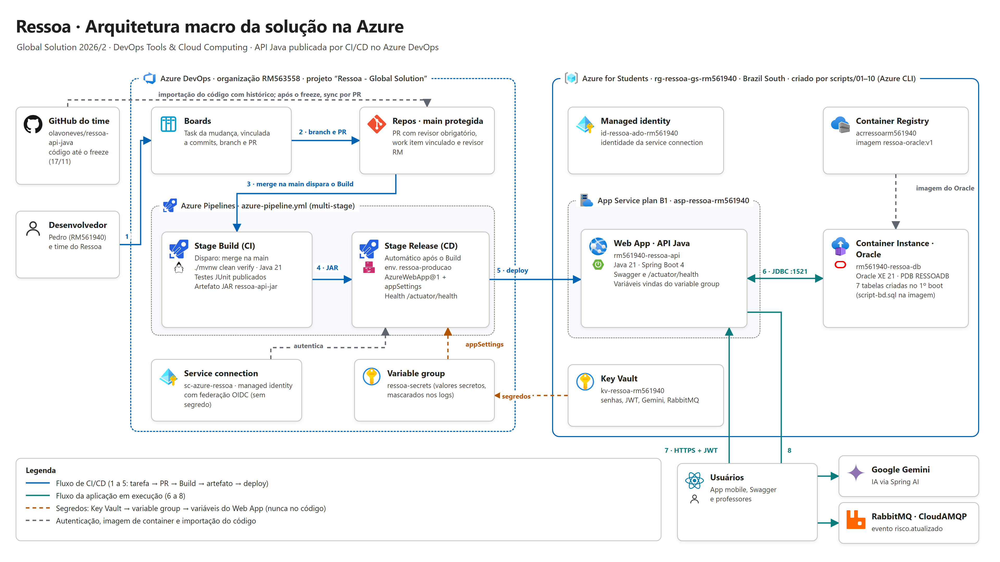

# Ressoa — API principal (Java)

[](https://github.com/olavoneves/ressoa-api-java/actions/workflows/ci.yml)

> **Matar a larva com som antes que a seca vire epidemia.**
> Global Solution FIAP 2026/2 — CitizenTech · Disciplina **Java Advanced**

O **Ressoa** combina um aparelho de ultrassom (ESP32 + transdutor piezoelétrico) que mata larvas do *Aedes aegypti* dentro de tambores e caixas d'água com uma **plataforma de risco** que diz onde instalar e quando agir. Esta API é o núcleo da plataforma: contas, bairros, aparelhos, avaliações de risco, orientação gerada por IA e alertas aos moradores.

**Cidadão beneficiado:** morador de periferia com abastecimento de água intermitente (prioridade a bebês, gestantes e idosos). **Segundo público:** agentes de endemias e gestores da vigilância em saúde.

## Integrantes — Grupo **Ressoa** · Turma **2TDSR**

| Nome | RM |
|---|---|
| Olavo Porto Neves | RM563558 |
| Pedro Henrique Dias França | RM561940 |
| Luiz Gustavo Gonçalves | RM564495 |
| Altamir Lima | RM562906 |
| Felipe Conte | RM562248 |

## Arquitetura

```text
[App Mobile] ──JWT──► API Java (este repo) ──► Oracle ◄── API .NET (telemetria) ◄── [Aparelho ESP32]
                         │   │
[Serviço de IA] ─────────┘   ├──Spring AI──► Google Gemini (orientação / plano de ação)
  POST /api/avaliacoes       └──publica "risco.atualizado"──► RabbitMQ ──► consumidor ──► NOTIFICACAO
```

- **Spring Boot 4.1 · Java 21** · Spring Data JPA · Spring Security (JWT HS256, resource server) · Spring AI (Gemini) · Spring AMQP · springdoc-openapi · Actuator.
- Organização por funcionalidade: `auth`, `usuario`, `bairro`, `dispositivo`, `avaliacao`, `orientacao`, `notificacao`, `mensageria`, `shared`.
- Erros padronizados em **Problem Details (RFC 9457)**; paginação com envelope `{ content, page, size, totalElements, totalPages, last }`.
- Modelo de dados: `scripts/script-bd.sql` (fonte única do DDL; usado também pela API .NET e pela disciplina de Banco).

### Requisito 5 — Arquitetura distribuída: **Opção A (RabbitMQ)**

Quando uma avaliação de risco muda o nível de um bairro, a API publica o evento `risco.atualizado` (exchange `ressoa.eventos`). Um consumidor assíncrono grava uma notificação para cada morador do bairro quando o risco sobe, exibida no app. Fila com DLQ e consumo idempotente.

## Como rodar

**Pré-requisitos:** JDK 21. O Maven vem pelo wrapper (`./mvnw`), não precisa instalar.

1. Suba Oracle e RabbitMQ locais (ou use o Oracle da FIAP e o CloudAMQP):
   ```bash
   docker compose -f infra/docker-compose.yml up -d oracle rabbitmq   # compose no repositório hub
   ```
2. Crie o esquema executando `scripts/script-bd.sql` no seu usuário Oracle.
3. Copie `.env.example` para `.env` e preencha (`DB_*`, `JWT_SECRET` com 32+ caracteres, `GEMINI_API_KEY`, `RABBITMQ_URL`).
4. Rode:
   ```bash
   # Linux/macOS (Git Bash)
   set -a && source .env && set +a && ./mvnw spring-boot:run
   # Windows PowerShell
   Get-Content .env | % { if ($_ -match '^([^#=]+)=(.*)$') { [Environment]::SetEnvironmentVariable($matches[1], $matches[2]) } }; .\mvnw spring-boot:run
   ```
5. Acesse **http://localhost:8080/swagger-ui.html**.

**Testes:** `./mvnw test` — rodam com H2 em memória, sem Oracle, LLM ou RabbitMQ (prontos para o CI).

### Variáveis de ambiente

| Variável | Descrição |
|---|---|
| `DB_URL`, `DB_USERNAME`, `DB_PASSWORD` | Conexão Oracle |
| `JWT_SECRET` | Segredo HS256 (≥ 32 bytes), **o mesmo da API .NET** |
| `JWT_EXPIRACAO_MINUTOS` | Validade do token (padrão 480) |
| `GEMINI_API_KEY`, `GEMINI_MODEL` | Google Gemini (padrão `gemini-3.1-flash-lite`; alternativa `gemini-3.8-flash`) |
| `AI_CHAT_PROVIDER` | `google-genai` (padrão) ou `none` (usa orientação de contingência) |
| `RABBITMQ_URL` | URI AMQP (ex.: CloudAMQP `amqps://...`) |
| `SEED_HABILITADO`, `SEED_SENHA_PADRAO` | Carga de dados de demonstração com banco vazio |

## Usuários de teste

Criados automaticamente com o banco vazio (`SEED_HABILITADO=true`). Senha: o valor de `SEED_SENHA_PADRAO` (padrão de desenvolvimento: `Ressoa@2026`).

| E-mail | Papel | Observação |
|---|---|---|
| `gestor@ressoa.app` | GESTOR | Gestora da vigilância (Jardim Ângela, SP) |
| `morador@ressoa.app` | CIDADAO | Maria — 2 aparelhos no Jardim Ângela |
| `joao@ressoa.app` | CIDADAO | João — 1 aparelho no Grajaú |
| `ia-servico@ressoa.app` | GESTOR | Conta do serviço de IA (grava avaliações) |

## Endpoints principais

| Método e rota | Acesso | Descrição |
|---|---|---|
| `POST /api/auth/registro` | público | Cadastro do morador (nome, e-mail, senha, bairro) — já devolve o token |
| `POST /api/auth/login` | público | `{ token, tipo, expiraEm, papel, usuario }` |
| `GET /api/auth/me` | autenticado | Perfil do usuário logado |
| `GET /api/bairros`, `GET /api/bairros/{id}` | público | Lista paginada com filtros `nome`, `municipio`, `uf`, `nivel` e o nível de risco atual |
| `POST /api/bairros`, `PUT /api/bairros/{id}`, `DELETE /api/bairros/{id}` | GESTOR | CRUD de bairros |
| `GET /api/dispositivos`, `GET /api/dispositivos/{id}` | CIDADAO (os seus) · GESTOR (todos) | Aparelhos Ressoa, paginado |
| `POST /api/dispositivos`, `PUT /api/dispositivos/{id}`, `DELETE /api/dispositivos/{id}` | CIDADAO (os seus) · GESTOR | Cadastro do aparelho instalado no recipiente |
| `GET /api/avaliacoes`, `GET /api/avaliacoes/{id}` | autenticado | Histórico de risco por bairro e semana (filtros `bairroId`, `nivel`) |
| `POST /api/avaliacoes` | GESTOR (e conta do serviço de IA) | Registra a avaliação; sem `nivel`, ele é calculado pelos indicadores. Se o nível mudar, publica `risco.atualizado` |
| `POST /api/bairros/{id}/orientacao` | autenticado | **Spring AI:** CIDADAO recebe orientação simples ao morador; GESTOR recebe plano de ação |
| `GET /api/notificacoes` | autenticado | Alertas do morador (gerados pelo consumidor RabbitMQ), paginado |
| `GET /api/notificacoes/nao-lidas/contagem` | autenticado | Badge de não lidas no app |
| `PATCH /api/notificacoes/{id}/lida` | autenticado (dono) | Marca como lida |
| `/swagger-ui.html`, `/v3/api-docs`, `/actuator/health` | público | Documentação e saúde |

## Requisitos da disciplina

| # | Requisito | Onde está |
|---|---|---|
| 1 | API REST com ≥ 3 entidades relacionadas, CRUD JPA e paginação | 5 entidades JPA relacionadas: `Bairro` 1-N `Usuario` 1-N `Dispositivo`; `Bairro` 1-N `AvaliacaoRisco` 1-N `Notificacao` N-1 `Usuario` (o esquema completo tem 7 tabelas, com `LEITURA` gravada pela API .NET e `AUDITORIA` pelo gatilho do banco). CRUD paginado em bairros e dispositivos; listas paginadas em avaliações e notificações |
| 2 | Bean Validation + `@RestControllerAdvice` | DTOs `record` com `@NotBlank`, `@Email`, `@Pattern`, `@DecimalMin`… · `shared/exception/GlobalExceptionHandler` responde em Problem Details (400, 401, 403, 404, 409, 422) |
| 3 | Spring Security + JWT com 2 papéis | `shared/security` (resource server HS256) · `CIDADAO` e `GESTOR` com `@PreAuthorize` e regra de dono nos aparelhos e notificações |
| 4 | Spring AI integrado ao fluxo | `orientacao/OrientacaoService` usa `ChatClient` com prompts por papel (`PromptsOrientacao`) a partir do nível de risco real do bairro. Resposta do morador fica em cache em `AVALIACAO_RISCO.ORIENTACAO_IA`; se o LLM falhar, `OrientacaoContingencia` responde (`geradaPorIa=false`) |
| 5 | Arquitetura distribuída — **Opção A** | `mensageria/` publica `risco.atualizado` após o commit; `notificacao/RiscoAtualizadoListener` consome, com retry, DLQ e idempotência (`UK_NOTIFICACAO_USUARIO_AVALIACAO`) |
| 6 | Swagger + README + consumo pelo app | springdoc com `bearerAuth` · este README · rotas usadas pelo app Mobile |

### Regra de classificação do risco (gatilhos do briefing)

| Nível | Gatilho | Ação recomendada |
|---|---|---|
| VERMELHO | casos > 100 por 100 mil habitantes | Plano de emergência, com prioridade a bebês, gestantes e idosos |
| LARANJA | Rt > 1 | Bloqueio da transmissão nos primeiros casos e salas de hidratação |
| AMARELO | temperatura mínima média > 22 °C | Mais pulsos por dia, mutirão contra criadouros e alerta aos moradores |
| VERDE | nenhum gatilho | Instalar o Ressoa nos bairros com água intermitente |

## Roteiro de demonstração (Swagger)

1. `POST /api/auth/login` com `gestor@ressoa.app` → **Authorize** com o token.
2. `POST /api/avaliacoes` com `{ "bairroId": 1, "semanaEpidemiologica": 202647, "casos100k": 130.5 }` → nível calculado **VERMELHO**; o evento `risco.atualizado` vai para o RabbitMQ.
3. `POST /api/bairros/1/orientacao` → plano de ação do gestor gerado pelo Gemini.
4. Login com `morador@ressoa.app` → `GET /api/notificacoes` mostra o alerta criado pelo consumidor; `POST /api/bairros/1/orientacao` traz a orientação simples ao morador.
5. `GET /api/dispositivos` → só os aparelhos da Maria; o status diário vem da API .NET (`ressoa-api-dotnet`).

## Deploy

| Ambiente | URL |
|---|---|
| **API pública (Render)** | https://ressoa-api-java.onrender.com |
| Swagger | https://ressoa-api-java.onrender.com/swagger-ui.html |
| Saúde | https://ressoa-api-java.onrender.com/actuator/health |
| API de telemetria (.NET) | https://ressoa-api-dotnet.onrender.com/swagger |

- Hospedagem em contêiner Docker (`dockerfiles/Dockerfile`) pelo blueprint `render.yaml`, com banco **Oracle FIAP** e **CloudAMQP** (RabbitMQ). Segredos só nas variáveis de ambiente do Render.
- Plano gratuito: o workflow `manter-ativa.yml` faz um *ping* a cada 10 min para a API não hibernar. Se a primeira chamada demorar, aguarde até 4 min (inicialização a frio).
- Deploy da disciplina de DevOps: Azure App Service via Azure DevOps (`azure-pipeline.yml`). Veja a seção abaixo.

## DevOps Tools & Cloud Computing — Global Solution

A API Java também roda na **Azure**, com CI/CD no **Azure DevOps**. O código de entrega fica no Azure Repos (projeto privado `Ressoa - Global Solution`), e os arquivos de DevOps estão espelhados aqui.

| | |
|---|---|
| **Organização no Azure DevOps** | https://dev.azure.com/RM563558 |
| **Vídeo de DevOps** | https://youtu.be/dDE-D5OLjfs |
| **Documentação completa** | [README-DEVOPS.md](README-DEVOPS.md): ordem dos scripts, pipeline, variáveis e banco |



| Item | Onde está |
|---|---|
| Provisionamento (Azure CLI) | `scripts/00_variables.sh` a `scripts/10_smoke-tests.sh`, mais `97_pausar.sh`, `98_retomar.sh` e `99_cleanup.sh` |
| DDL do banco | `scripts/script-bd.sql` |
| Imagem do Oracle XE (ACI + ACR) | `dockerfiles/Dockerfile.oracle` e `dockerfiles/oracle-init/` |
| Pipeline Build + Release (YAML) | `azure-pipeline.yml`: `mvnw clean verify`, testes JUnit e artefato `ressoa-api-jar` no Build; deploy no Web App `rm561940-ressoa-api` e checagem do `/actuator/health` na Release |
| Segredos | Key Vault `kv-ressoa-rm561940` → variable group secreto `ressoa-secrets`; nenhuma senha no repositório |

## Declaração de uso de IA

| Ferramenta | Uso |
|---|---|
| Claude Code (Anthropic) | Apoio na estruturação do projeto, geração e revisão de código, testes e documentação. Todo o código foi revisado e é explicado pela equipe. |
| Google Gemini (via Spring AI) | Funcionalidade do produto: gera a orientação ao morador e o plano de ação do gestor a partir do nível de risco. |
