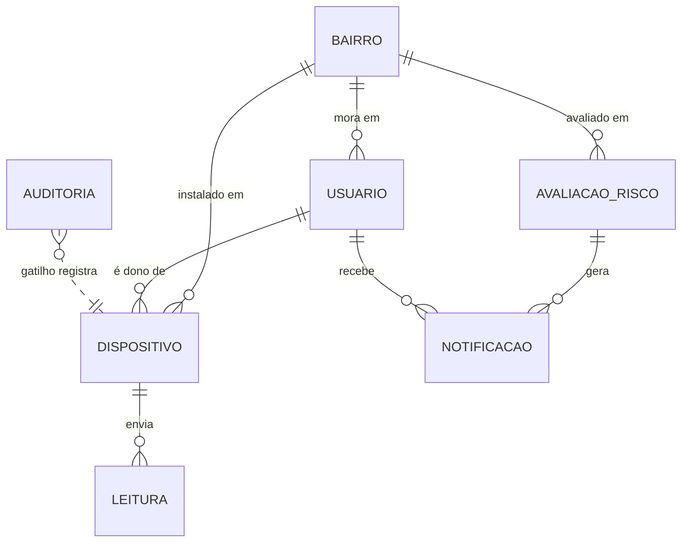

# Ressoa — Banco de Dados (Oracle PL/SQL + MongoDB)

> Global Solution FIAP 2026/2 — CitizenTech · Disciplina **Mastering Relational and Non-Relational Database**
> Grupo **Ressoa** · Turma **2TDSR**

## 1. Problema CitizenTech

Nas periferias com **abastecimento de água intermitente**, as famílias guardam água em tambores, baldes e caixas d'água, que viram criadouros do *Aedes aegypti*. Com o calor do El Niño, a dengue explode nesses bairros.

O **Ressoa** é um aparelho de ultrassom (ESP32 + transdutor piezoelétrico) que fica dentro do recipiente e mata as larvas sem veneno. A plataforma cruza dados epidemiológicos e climáticos para dizer **onde instalar e quando agir**.

O banco de dados guarda:
- os bairros e o nível de risco de cada um;
- os aparelhos instalados;
- a telemetria diária dos aparelhos;
- uma trilha de auditoria.

As regras de negócio também ficam no banco, para valerem para qualquer origem: API Java, API .NET ou SQL direto.

## 2. Modelo relacional (Oracle)

Fonte única do DDL: [`../script-bd.sql`](../script-bd.sql). O mesmo esquema é usado pelas APIs Java e .NET, que estão no ar no Render com este banco.



| Tabela | Papel |
|---|---|
| `BAIRRO` | Território monitorado: código IBGE, água intermitente e nível de risco atual |
| `USUARIO` | Morador (`CIDADAO`) ou gestor (`GESTOR`). Pela LGPD, guarda só nome, e-mail e bairro |
| `DISPOSITIVO` | Aparelho Ressoa num recipiente: tipo, volume, pulsos/dia e status |
| `LEITURA` | Telemetria diária: bateria, temperatura da água, pulso OK. Tem chave de idempotência única |
| `AVALIACAO_RISCO` | Nível semanal por bairro (casos/100 mil, Rt, temperatura mínima) |
| `NOTIFICACAO` | Alerta ao morador quando o risco do bairro sobe |
| `AUDITORIA` | Trilha gravada pelo gatilho: tabela, operação, valor antigo e novo (JSON), usuário e data |

## 3. Scripts e ordem de execução

| Ordem | Arquivo | Conteúdo | Requisito |
|---|---|---|---|
| 0 | `../script-bd.sql` | DDL: 7 tabelas, PK, FK, CHECK, UNIQUE e índices | 1 |
| 1 | `01-dados-teste.sql` | Carga de referência: 6 bairros, 8 usuários, 8 aparelhos, 24 avaliações e 45 leituras | 1 |
| 2 | `02-pacotes.sql` | Pacotes `PKG_RISCO` e `PKG_DISPOSITIVO` (specification + body) | 2 e 4 |
| 3 | `03-gatilhos.sql` | `TRG_AUDITORIA_DISPOSITIVO` e `TRG_BATERIA_BAIXA` | 3 |
| 4 | `04-blocos-anonimos.sql` | 2 blocos com cursor, repetição e decisão | 1 |
| 5 | `05-testes.sql` | 28 testes automatizados dos pacotes e gatilhos | 4 |
| 6 | `06-relatorios-oracle.sql` | Relatórios R1 a R4 no Oracle (base da comparação) | 6 |
| — | `mongodb/00-exportar-do-oracle.sql` | Gera os documentos JSON a partir do Oracle (transição) | 6 |
| — | `mongodb/01-carga.js` | `use`, `createCollection` (validação e série temporal), `insertMany`, índices | 5 |
| — | `mongodb/02-relatorios.js` | R1 e R2 (`find`), R3 e R4 (`aggregate`) | 6 |

### Como executar

**Oracle.** No SQL*Plus ou SQLcl, a partir desta pasta e com o esquema já criado pelo `script-bd.sql`, rode `@00-executar-tudo.sql`. No SQL Developer, abra cada arquivo na ordem e execute com **F5 (Run Script)**, deixando o painel *DBMS Output* ligado.

```sql
@../script-bd.sql
@00-executar-tudo.sql
```

**MongoDB** (`mongosh`, versão 6 ou superior):

```bash
mongosh --file mongodb/01-carga.js
mongosh --file mongodb/02-relatorios.js
```

Para usar um ambiente local: `docker compose -f infra/docker-compose.yml up -d oracle mongodb`, a partir do repositório hub.

**Segurança dos scripts:**
- Todos são reexecutáveis.
- A carga só insere o que ainda não existe, pela chave natural de cada tabela, e convive com os dados criados pela API.
- Os testes desfazem tudo no final (`ROLLBACK`).
- Blocos e relatórios só leem.

Por isso podem rodar no banco em produção sem afetar o app.

## 4. Objetos PL/SQL

### Pacote `PKG_RISCO`

| Objeto | Regra de negócio |
|---|---|
| `fn_nivel_risco(casos_100k, rt, temp_min)` | Tabela de gatilhos do Ressoa, em que o mais grave vence: casos > 100 → **VERMELHO**; Rt > 1 → **LARANJA**; temperatura mínima > 22 °C → **AMARELO**; senão **VERDE**. É a mesma regra do `ClassificadorRisco` da API Java |
| `pr_atualizar_risco_bairro(bairro, semana, casos, rt, temp, ...)` | Valida bairro e semana (AAAASS), calcula o nível e grava a avaliação. Atualiza `BAIRRO.NIVEL_RISCO` com `SELECT ... FOR UPDATE` e informa se o risco **subiu**, o que dispara o alerta aos moradores |
| `fn_peso_nivel(nivel)` | Auxiliar: ordena os níveis (VERDE = 1 … VERMELHO = 4) |

### Pacote `PKG_DISPOSITIVO`

| Objeto | Regra de negócio |
|---|---|
| `fn_pct_dispositivos_ativos(bairro)` | Cobertura: % de aparelhos `ATIVO` no bairro. Ignora os `INATIVO`, desligados pelo dono |
| `fn_taxa_sucesso_pulso(dispositivo, dias)` | % de pulsos de ultrassom bem-sucedidos no período |
| `pr_registrar_leitura(serie, chave, bateria, temp, pulso, ...)` | Leitura **idempotente**: com a mesma chave e o mesmo conteúdo, devolve a leitura já gravada; com conteúdo diferente, dá erro. Aparelho inativo é rejeitado, e bateria recarregada reativa o aparelho |

Erros de negócio:

| Código | Erro |
|---|---|
| -20001 | Bairro inexistente |
| -20002 | Semana inválida |
| -20003 | Indicador fora da faixa |
| -20011 | Aparelho inexistente |
| -20012 | Aparelho inativo |
| -20013 | Leitura inválida |
| -20014 | Chave de idempotência reutilizada com outro conteúdo |

### Gatilhos

| Gatilho | O que faz |
|---|---|
| `TRG_AUDITORIA_DISPOSITIVO` | **Trilha de auditoria.** Em INSERT, UPDATE e DELETE de `DISPOSITIVO`, grava em `AUDITORIA` a tabela, a operação, o **valor antigo** e o **valor novo** (JSON), o usuário do banco e a **data/hora** |
| `TRG_BATERIA_BAIXA` | Leitura em tempo real com bateria < 15% marca o aparelho como `BATERIA_BAIXA`. Leituras antigas, acumuladas enquanto o aparelho estava sem sinal, não regridem o status, e um aparelho `INATIVO` não é alterado. É a mesma regra da API .NET |

Os dois funcionam em cadeia: a mudança de status feita pelo `TRG_BATERIA_BAIXA` também é auditada.

**Convenção de datas.** As datas de negócio (`REGISTRADA_EM`, `CRIADA_EM`) ficam em **UTC**, como nas APIs. O servidor da FIAP está em -03:00, então o PL/SQL usa `SYS_EXTRACT_UTC(SYSTIMESTAMP)`.

### Blocos anônimos

1. **Painel de prioridade** (cursor + `FOR LOOP` + `IF/ELSIF`): cruza o risco do bairro com a cobertura de aparelhos e define a prioridade da ação.
2. **Conferência da classificação** (cursor com funções analíticas + `LOOP` + `IF`/`CASE`): recalcula o nível da avaliação mais recente com `fn_nivel_risco`, aponta divergências e mostra a tendência em relação à semana anterior.

Saída do bloco 1 com a carga de referência:

```text
Bairro                      Nível     Aparelhos  Ativos   Prioridade
Complexo da Maré/RJ         VERMELHO  2          50%      PRIORIDADE MÁXIMA
Jardim Ângela/SP            VERMELHO  2          100%     MONITORAR DE PERTO
Grajaú/SP                   LARANJA   1          100%     MONITORAR DE PERTO
Ibura/PE                    LARANJA   1          0%       PRIORIDADE MÁXIMA
Vila Pinho/MG               AMARELO   1          100%     ROTINA
Moema/SP                    VERDE     0          0%       ROTINA
Bairros em prioridade máxima: 2
```

### Testes (`05-testes.sql`)

São 28 asserções `[PASSOU]`/`[FALHOU]`:
- todos os níveis, limites exatos e nulos de `fn_nivel_risco`;
- gravação, atualização do bairro, "risco subiu" e os erros -20001 e -20002 do procedimento de risco;
- cobertura com aparelho `INATIVO` excluído (66,7%);
- auditoria de INSERT e de UPDATE, com valor antigo e novo;
- idempotência (sem duplicar e com o erro -20014);
- `BATERIA_BAIXA` pelo gatilho, auditoria em cadeia, reativação e leitura antiga que não muda o status;
- taxa de pulso de 75% e os erros -20011, -20012 e -20013.

Resultado no Oracle 19c (FIAP) e no 23ai (Docker): `Testes: 28 · passaram: 28 · falharam: 0`.

## 5. Transição Oracle → MongoDB

### Mapeamento relacional → documental

| Oracle | MongoDB | Decisão |
|---|---|---|
| `BAIRRO` | collection **`bairros`** (`_id` = `BAIRRO.ID`) | Documento principal: o app e o gestor consultam por bairro |
| `AVALIACAO_RISCO` (1-N) | array **`avaliacoes`** incorporado em `bairros` | **Incorporado:** sempre lido junto com o bairro, cresce pouco (uma por semana) e nunca é consultado sozinho |
| `DISPOSITIVO` (1-N) | array **`dispositivos`** incorporado em `bairros` | **Incorporado:** poucos por bairro; a cobertura vira um `$unwind` sem junção. O dono vai só pelo nome, sem e-mail (LGPD) |
| `LEITURA` (N por aparelho) | collection **`leituras`** (*time series*) | **Referenciado:** cresce sem limite, uma por aparelho por dia. Incorporar estouraria o limite de 16 MB do documento. Usa *referência estendida* (`dispositivo.numeroSerie` e `bairroId`), evitando junção nos relatórios |
| `USUARIO`, `NOTIFICACAO`, `AUDITORIA` | não migrados | Dados de autenticação e operação, transacionais e sensíveis (LGPD), que continuam no Oracle |

Exemplo de documento da collection `bairros`:

```json
{
  "_id": 3, "nome": "Complexo da Maré", "municipio": "Rio de Janeiro", "uf": "RJ",
  "codigoIbge": "3304557", "aguaIntermitente": true, "nivelRisco": "VERMELHO",
  "avaliacoes": [ { "semanaEpidemiologica": 202645, "nivel": "VERMELHO", "casos100k": 131, "rt": 1.31,
                    "tempMinMedia": 25.1, "criadaEm": "2026-11-14T18:00:00Z" } ],
  "dispositivos": [ { "numeroSerie": "RSA-2026-0004", "tipoRecipiente": "TAMBOR", "volumeLitros": 200,
                      "pulsosPorDia": 2, "status": "ATIVO", "dono": "Ana Souza" } ]
}
```

**Correspondência entre os registros:**
- `bairros._id` corresponde a `BAIRRO.ID`;
- `dispositivos.numeroSerie` corresponde a `DISPOSITIVO.NUMERO_SERIE`;
- `leituras.chaveIdempotencia` corresponde a `LEITURA.CHAVE_IDEMPOTENCIA`.

O script `mongodb/00-exportar-do-oracle.sql` gera esses mesmos documentos direto do Oracle (`JSON_OBJECT`/`JSON_ARRAYAGG`). A transição sai do próprio modelo relacional.

**Recursos do MongoDB usados:**
- `$jsonSchema` para validar `bairros`;
- collection *time series* para `leituras`;
- índices de apoio aos relatórios;
- `insertMany` com 6 + 45 = **51 documentos**.

### Por que migrar parte dos dados

A telemetria cresce todo dia, com cada vez mais aparelhos. As consultas de painel ("como está o bairro") leem o bairro inteiro de uma vez. O modelo documental entrega isso:
- sem junções;
- com escala horizontal;
- com a série temporal compactada.

O Oracle continua como **fonte da verdade transacional**: login, integridade referencial, PL/SQL e auditoria.

## 6. Relatórios: MongoDB × Oracle

Executados com a carga de referência. **Os resultados são idênticos nos dois bancos.**

### R1 (`find`) — Leituras com falha no pulso ou bateria < 20% (08 a 14/11)

| Aparelho | Data | Bateria | Pulso |
|---|---|---|---|
| RSA-2026-0007 | 09/11 09:00 | 61 | falhou |
| RSA-2026-0001 | 11/11 09:00 | 83 | falhou |
| RSA-2026-0003 | 13/11 09:00 | 63 | falhou |
| RSA-2026-0005 | 13/11 09:00 | 18 | ok |
| RSA-2026-0005 | 14/11 09:00 | 15 | falhou |

- **Oracle:** `LEITURA JOIN DISPOSITIVO`, `WHERE ... AND (PULSO_OK = 'N' OR BATERIA_PCT < 20)`.
- **MongoDB:** `find({ registradaEm: {...}, $or: [...] })`, sem junção (referência estendida).

### R2 (`find`) — Bairros com água intermitente em risco LARANJA ou VERMELHO

| Bairro | Município | Nível | SE | Casos/100 mil | Rt |
|---|---|---|---|---|---|
| Complexo da Maré | Rio de Janeiro | VERMELHO | 202645 | 131,0 | 1,31 |
| Grajaú | São Paulo | LARANJA | 202645 | 71,8 | 1,15 |
| Ibura | Recife | LARANJA | 202645 | 66,0 | 1,08 |
| Jardim Ângela | São Paulo | VERMELHO | 202645 | 112,4 | 1,26 |

- **Oracle:** `BAIRRO JOIN AVALIACAO_RISCO` com subconsulta da última avaliação (`KEEP DENSE_RANK LAST`).
- **MongoDB:** `find` com projeção `avaliacoes: { $slice: -1 }`.

### R3 (`aggregate`) — Cobertura de aparelhos ativos por bairro

| Bairro | Aparelhos | Ativos | % ativos |
|---|---|---|---|
| Ibura | 1 | 0 | 0 |
| Complexo da Maré | 2 | 1 | 50 |
| Grajaú | 1 | 1 | 100 |
| Jardim Ângela | 2 | 2 | 100 |
| Vila Pinho | 1 | 1 | 100 |

- **Oracle:** `GROUP BY`, conferido coluna a coluna com `PKG_DISPOSITIVO.fn_pct_dispositivos_ativos`.
- **MongoDB:** `$unwind` → `$match` → `$group` → `$project` → `$sort`.

### R4 (`aggregate`, extra) — Taxa de sucesso do pulso e bateria média por bairro

| Bairro | Leituras | % pulso OK | Bateria média |
|---|---|---|---|
| Ibura | 3 | 66,7 | 61,0 |
| Grajaú | 7 | 85,7 | 69,0 |
| Complexo da Maré | 14 | 92,9 | 51,5 |
| Jardim Ângela | 14 | 92,9 | 79,5 |
| Vila Pinho | 7 | 100,0 | 86,0 |

- **Oracle:** junção de 3 tabelas.
- **MongoDB:** `$group` na série temporal + `$lookup` só para o nome do bairro.

> Em produção, a API .NET muda o status dos aparelhos ao longo do tempo. Por exemplo, ela marca `SEM_SINAL` depois de 26 h sem leitura, e o gatilho de auditoria registra essa mudança. Por isso a comparação é feita com a carga de referência num esquema novo, como no roteiro acima.

## 7. Evidências

As saídas acima foram obtidas executando os scripts no **Oracle 19c da FIAP**, no **Oracle Free 23ai** (Docker) e no **MongoDB 8** (Docker). Para a entrega, gere os prints da execução: saída do `00-executar-tudo.sql` (blocos, testes e relatórios), do `SELECT * FROM AUDITORIA` e do `mongosh` com os relatórios.

## Declaração de uso de IA

| Ferramenta | Uso |
|---|---|
| Claude Code (Anthropic) | Apoio na estruturação dos scripts, geração e revisão de código PL/SQL e MongoDB e documentação. O conteúdo foi revisado e é explicado pela equipe. |
